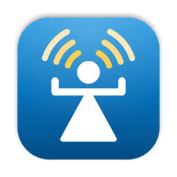
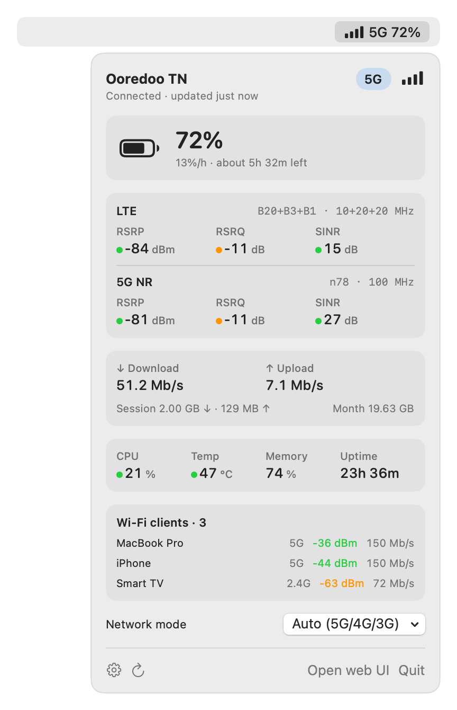
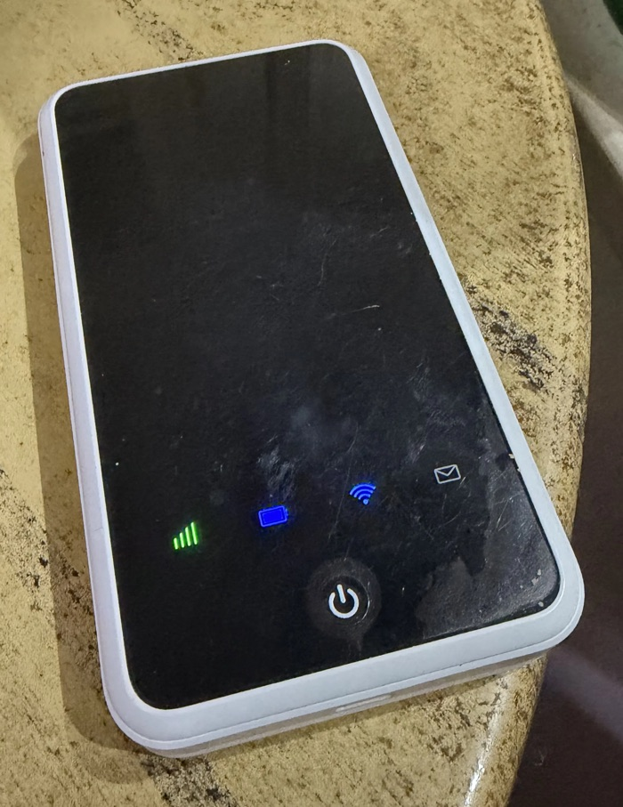

<p align="center"></p>

<h1 align="center">Rezo</h1>
<p align="center"><em>Famma rézo wala la?</em> (Is there signal or not?)</p>

*Rezo* is Tunisian for mobile signal ("réseau"). The icon is the Tanit sign of Carthage, broadcasting.

A macOS menu bar app for the **ZLT X31** 5G router, sold by Ooredoo as the "Ooredoo 5G" box. It shows signal, network type and battery in the menu bar. Click it for the full picture: LTE and 5G signal quality, bands, live throughput, data used, CPU, temperature, connected Wi-Fi clients and a network-mode switch (for example, 4G only to save battery).

<p align="center">
  <picture>
    <source media="(prefers-color-scheme: dark)" srcset="docs/screenshot-dark.png">
    
  </picture>
</p>
<p align="center"><sub>Screenshot with sample data.</sub></p>

The repo also contains a small Python client (`box_client.py`) and a map of the box's web API (`docs/api-reference.html`), in case you want to build your own dashboard.

> **Independent project.** Rezo is not affiliated with, endorsed by, or sponsored by Ooredoo, ZLT, ZTE or Quectel. See the [disclaimer](#disclaimer).

## Compatibility



Tested on a ZLT X31C running firmware 1.0.0.24 (config X31-TN0303, Ooredoo Tunisia). Other ZLT boxes that use the same web UI may work: it posts JSON to `/cgi-bin/http.cgi`, and its login page saves `username_sunsea` in your browser storage. If you try one, please open an issue with the model and firmware.

Rezo needs macOS 14 or later.

<br clear="right">

## Install

With [Homebrew](https://brew.sh):

```sh
brew install aabichou/tap/rezo
brew services start rezo     # launch now and at every login
```

On Apple Silicon Macs with macOS 14 or later, this installs a prebuilt app in a few seconds. Other Macs build it from source, which needs the Xcode command line tools.

Homebrew keeps the app in its own folder. Run `rezo` to open it, or `ln -sf "$(brew --prefix)/opt/rezo/Rezo.app" /Applications/Rezo.app` to also see it in Spotlight and Launchpad. To update, run `brew upgrade rezo`.

<details>
<summary>Other ways to install</summary>

**Download:** each [release](https://github.com/aabichou/rezo/releases) has a `Rezo-<version>.zip`. The app isn't notarized by Apple, so on first launch macOS blocks it. Open System Settings → Privacy & Security and click **Open Anyway**.

**Build from source** (needs Xcode or the command line tools):

```sh
git clone https://github.com/aabichou/rezo.git
cd rezo/Rezo
./build.sh                       # produces Rezo.app
mv Rezo.app /Applications/
open /Applications/Rezo.app
```

</details>

### First run

1. If macOS asks whether Rezo may access devices on your local network, allow it. Without that permission Rezo can't reach the box.
2. Click the menu bar icon. Rezo finds the box by itself and shows something like "Found ZLT X31 at 192.168.100.1". Enter the admin password and click **Connect**. Signal and battery show up even before you log in.
3. Rezo tries the login once. If it works, the password goes into your macOS Keychain; it is never written to disk anywhere else. A wrong password shows an error straight away instead of being retried, because the box locks the account after 3 failed attempts.

To find the box, Rezo checks your network's router address, then a few common box addresses (`192.168.100.1`, `192.168.0.1`, `192.168.1.1`, `192.168.8.1`, `192.168.10.1`). It looks for a device that answers the box's API. If the box changes address later, Rezo finds it again. To pin an address or change the username, open **Advanced** in the setup form, under the gear icon.

### Can't see the icon?

- Menu bar managers such as **Ice** and **Bartender** put new icons in their hidden section. Move Rezo to the visible section in their settings.
- On MacBooks with a notch, a crowded menu bar can hide icons behind the notch. ⌘-drag other icons out of the menu bar to make room.

## How it works

The box's web UI talks to one endpoint: JSON `POST`s to `https://<box>/cgi-bin/http.cgi`, each with a numeric `cmd`. Login sends `sha256(token + password)`, where the token comes from `cmd 232`. See [docs/api-reference.html](docs/api-reference.html) for the full map.

- **Every 15 s, no login:** `cmd 113` and `cmd 133` return network type, signal (RSRP, RSRQ, SINR), bands, cell, WAN IP and battery.
- **Every 30 s, with login:** `cmd 1002`, `1001`, `1000` and `256` return traffic counters, CPU, temperature, memory, Wi-Fi clients and network mode.
- **On demand:** `cmd 256` changes the network mode. This is the only setting Rezo changes, and only when you pick a mode from its menu. Changing it reconnects the modem, so expect about 10 seconds offline and a new WAN IP.

### The box allows one login at a time

A new login immediately ends the previous session. While detailed stats are on, Rezo and the box's web UI take turns:

- If Rezo sees that someone else logged in, it pauses detailed stats for 5 minutes instead of taking the session back.
- The panel's **Open web UI** button pauses Rezo for 10 minutes.
- If you mostly want signal and battery, turn off detailed stats. That part needs no login.

## Security notes

- The box uses a self-signed HTTPS certificate. Rezo accepts it for the configured box address only; every other host gets normal certificate checks.
- The admin password is stored in the macOS Keychain, one item per box address.
- Be aware that the box answers `cmd 133` **without a password**, including the SIM's IMSI and ICCID, the modem's IMEI and the WAN IP. Anyone on your Wi-Fi can read them. Rezo doesn't cause this, but it's worth knowing before you share your Wi-Fi.

## Troubleshooting

```sh
rezo --check      # Homebrew install
/Applications/Rezo.app/Contents/MacOS/Rezo --check   # manual install
```

This polls the box for 8 seconds using your saved settings and prints everything the panel would show. It doesn't print the password.

## Python client

```sh
BOX_PASSWORD=... python3 box_client.py          # one JSON snapshot
```

`BOX_URL` and `BOX_USER` override the defaults (`https://192.168.100.1`, `admin`). Use `Box().get(cmd)`, `Box().post(cmd, **params)` and `Box().set_network_mode("4")` from your own scripts.

## Releasing

Push a version tag:

```sh
git tag v0.2.0 && git push origin v0.2.0
```

The [release workflow](.github/workflows/release.yml) then builds a universal app zip and a Homebrew bottle, publishes both to a GitHub Release, and updates the formula in [aabichou/homebrew-tap](https://github.com/aabichou/homebrew-tap).

## Icon and screenshots

`Rezo/scripts/make-icon.swift` draws the icon with CoreGraphics. To regenerate `Rezo/Resources/AppIcon.icns` and `docs/icon.png` after changing it, run `Rezo/scripts/make-icns.sh`.

The README screenshots are rendered from the real panel with fixed sample data, so they never show a real cell ID, IP address or device name. To regenerate them after a UI change, run `Rezo/.build/release/Rezo --snapshot docs` from the repo root, after building.

## Disclaimer

Rezo is an independent, unofficial project. It is not affiliated with, endorsed by, sponsored by or connected to Ooredoo, ZLT, ZTE Corporation or Quectel Wireless Solutions, or any of their subsidiaries.

Ooredoo, ZLT, ZTE, Quectel and any related names, logos and product names are trademarks of their respective owners. They appear here only to describe which devices Rezo works with. No Ooredoo or ZLT logos or artwork are used. The app icon is original artwork based on the Tanit sign, a historical public-domain symbol.

Rezo talks to your own device through the same local web interface its built-in web page uses. It doesn't modify firmware or bypass any security, and it doesn't connect to any operator service. Changing device settings, such as the network mode, is your responsibility and may be subject to your operator's terms of service.

The software is provided "as is", without warranty of any kind. See [LICENSE](LICENSE).

## License

MIT
